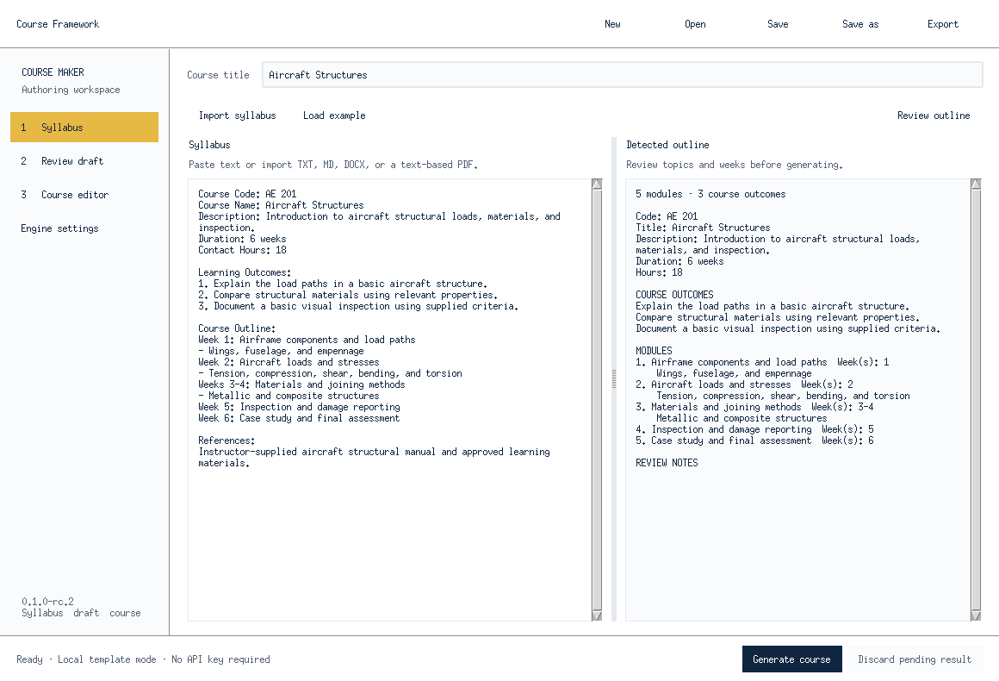

# Aero Academy interface alignment

Course Framework adopts Aero Academy's white/navy/gold visual language for future integration. Reference inspected: `Denberg28/Aeronautical-Open-Academy` main, `MainActivity.java` and `WorkspaceActivity.java` (29 October 2026). The current reference repository exposes the Android workspace; Windows Academy visual parity still needs side-by-side acceptance with the deployed Academy desktop build.

| Token / pattern | Course Framework |
|---|---|
| Paper | `#ffffff` |
| Navy text / primary actions | `#102640` |
| Secondary text | `#536174` |
| Dividers | `#e4e9f0` |
| Field background | `#fafbfd` |
| Selected navigation | `#e6b844` |
| Selection tint | `#fff7df` |
| Desktop type | Segoe UI, 10 pt body; 11 pt sections; 18 pt app title |
| Navigation | Compact left rail; Syllabus → Review draft → Course editor; Engine settings |
| Actions | New/Open/Save/Save as/Export in the top bar; Generate in the footer; acceptance beside the draft title |

`academy_theme.py` owns reusable visual tokens and Tk styles. The optional Streamlit interface uses the same palette and compact headings; `.streamlit/config.toml` supplies its native theme. Responsive helper labels wrap within their panel; native keyboard editing and focus indicators remain available. Alt+1/2/3/4 opens Syllabus/Review draft/Course editor/Engine settings. Ctrl+O and Ctrl+S retain Open and Save.

This change prepares the authoring interface visually. It does not connect Academy accounts, publish subjects, map course modules into Academy materials, or modify the version-1 course project/export schema. Future integration must define a versioned import contract and preserve instructor review before publication. It can map an accepted course to an Academy subject and its modules to materials after that contract is implemented.

Review native captures with `python tools/capture_ui.py ui-review` on Windows or an X display. CI retains screenshots for the syllabus, accepted-course editor, and settings at minimum size. Screenshots use the real Tk UI and sample syllabus, with no provider calls or credentials. Native automated minimum-size bounds checks are distinct from manual high-DPI and assistive-technology acceptance.

Preview: real Tk widgets on Xvfb Linux; the Linux font fallback differs from Windows Segoe UI.
